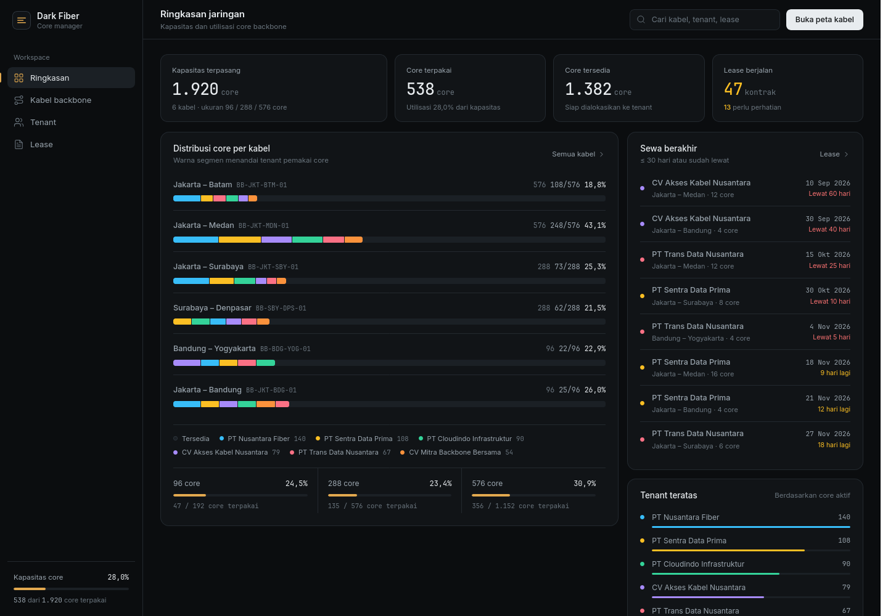
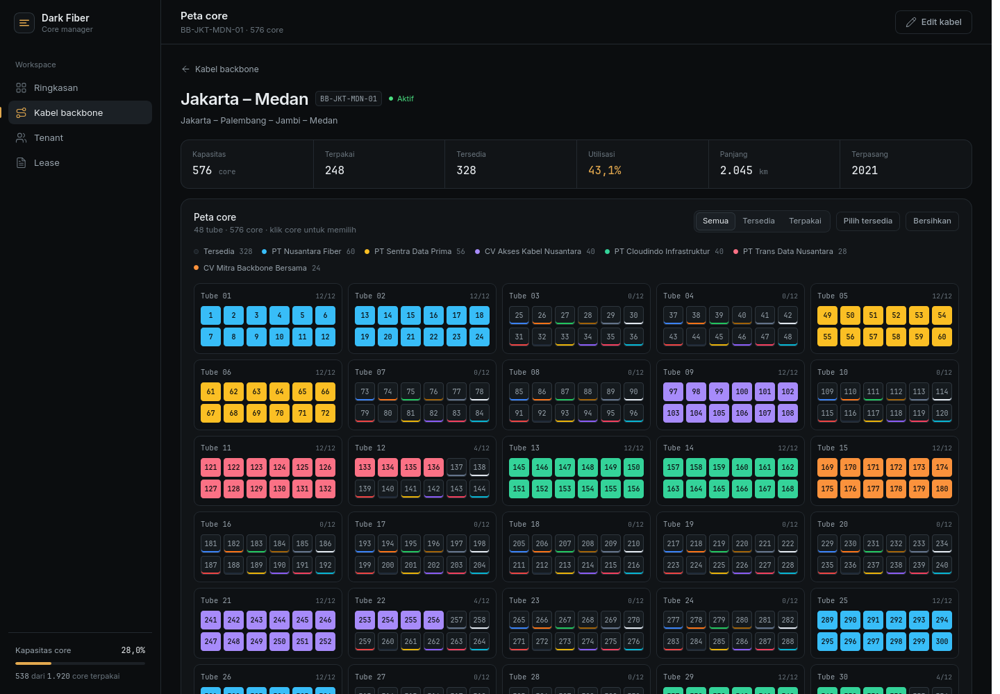
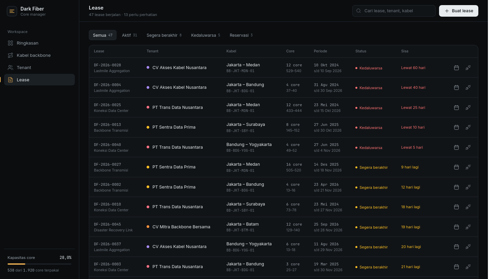

# dark-fiber-core-manager

| | |
| --- | --- |
| **Status** | `review` |
| **Created** | 2026-11-09 |
| **Last touched** | 2026-11-09 |

## Purpose

Dashboard manajemen core kabel backbone fiber optik berukuran 96, 288, dan 576 core untuk pengelolaan dark fiber tenant. Dipakai tim NOC/operasi untuk melihat kapasitas core, memetakan core per tube, mengalokasikan beberapa core sekaligus ke tenant, serta memantau masa sewa dan core yang harus segera dilepas.

Dashboard ini adalah versi baru dari `backbone-core-dashboard`. Versi lama tidak diubah dan tetap ada sebagai referensi.

## Fitur

- **Mirror sheet ke Ringkasan & Kabel Backbone (2026-11-09)** — semua data asli dari Peta OTB & rak masuk ke Ringkasan dan Kabel Backbone. Port dihitung kepake kalau kolom **Tujuan terisi** dan Port-nya ada (321/361 port, 88,9%). Nomor port di-parse jadi core: `Port 11-12` → core 11,12 teridentifikasi, `Port 27&30` → core 27,30. Total **632 core terpakai (0 lease + 632 sheet)** tersebar di 57 kabel, kapasitas **6.336 core**, utilisasi 10,0%. Angka card utama `X/Y` sekarang gabungan lease ∪ sheet (nggak 0/288 lagi). Peta core menandai core sheet sebagai **Splice/Sheet** (garis hijau) + lease tenant. Sync Google Sheet otomatis memperbarui ketiga halaman setiap 60 detik.
- Ringkasan kapasitas real dari plant: total perangkat plant (57 panel), 361 port terdaftar, 15 stasiun, 6.336 core kapasitas.
- Distribusi core per kabel dengan warna tenant, utilisasi per ukuran core (24 / 48 / 72 / 96 / 144 / 288 / 576).
- **Inventaris kabel berbasis plant asli** — setiap panel OTB/MDF/ODC dari Google Sheet otomatis menjadi baris `cables` (57 perangkat) saat sync. Tidak ada lagi kabel contoh.
- Peta core per tube (12 core per tube) dengan kode warna fiber TIA-598; halaman detail menampilkan tabel port OTB dari sheet di bawah peta.
- Pilih beberapa core (klik, shift-klik untuk rentang, atau "Pilih tersedia") lalu alokasikan sekaligus ke tenant.
- Filter peta berdasarkan status core (semua / tersedia / terpakai).
- Manajemen tenant: tambah, edit, kontak PIC, status aktif/suspend/nonaktif (6 tenant contoh tersedia sebagai titik awal).
- Manajemen lease: perpanjang tanggal berakhir, ubah keperluan/catatan, lepas core kembali ke tersedia. Belum ada lease palsu yang menempel ke perangkat real.
- Status lease dihitung otomatis: aktif, segera berakhir (≤30 hari), kedaluwarsa, reservasi, dilepas.
- Tambah/edit kabel manual (kelipatan 12 core) selain plant dari sheet.
- **Sinkronisasi Google Sheets** — tiap tab sheet menjadi gedung/rak; parser menangkap blok OTB (`No. Port | Tujuan | Ket`) secara side-by-side. Sync otomatis tiap 60 detik atau tekan "Sync sekarang". Read-only.
- **Search global lintas gedung** — kolom search di topbar (tekan `/` untuk fokus) mencari kabel + semua port OTB dari Google Sheet via `/api/sheet/search`. Ketik `alibaba`, `OTB 96.1`, atau `Port 11-12` dari halaman mana pun, dropdown tampilkan hasil Port→Tujuan, klik langsung lompat ke detail kabel atau tab Peta OTB. Search tabel OTB per tab tetap ada di halaman Peta OTB.
- Pencarian cepat di tabel OTB.
- Tanpa login, tanpa build step, tanpa CDN. Bisa dipakai offline.

## Cara Menjalankan

Butuh Python 3.10+ (lingkungan ini memakai Python 3.12). Tidak perlu install paket.

```bash
cd projects/dark-fiber-core-manager
./run.sh
```

Buka **http://localhost:4173**.

Port lain:

```bash
PORT=8080 ./run.sh
```

Database SQLite dibuat otomatis di `src/server/darkfiber.db` saat pertama kali dijalankan. Untuk mengulang data demo dari awal:

```bash
# hentikan server, lalu
rm src/server/darkfiber.db
./run.sh
```

## Alur Kerja

1. **Ringkasan** — lihat plant (OTB/MDF/ODC dari Google Sheet) dan ringkasan lease.
2. **Kabel backbone** — daftar 57+ plant equipment dari sheet. Klik untuk lihat detail port per panel.
3. **Peta OTB & rak** — tampilan visual per gedung/rak dengan daftar semua port.
4. **Tenant** — kelola data tenant.
5. **Lease** — kelola kontrak sewa core (terpisah dari plant).

### Sinkronisasi Google Sheets

Sheet sumber sudah dibuka publik, jadi tidak butuh API key. Server menyalin CSV dari 15 tab setiap 60 detik (atau sekali klik "Sync sekarang"). Hasil parse disimpan lokal — saat server restart, cache tetap ada sampai fetch berikutnya gagal.

Bisa atur ulang interval lewat environment variable:

```bash
SHEET_POLL_SECONDS=30 ./run.sh   # cek tiap 30 detik
```

Jika sheet berubah formatnya (misalnya tambah/mundur header kolom `Ket`), parser akan otomatis menyesuaikan. Kalau hasil parse aneh, buka halaman browser → konsol (`F12`) → cek notifikasi warning yang diturunkan server.

## Model Data

```
cables             kabel backbone — baris plant dari sheet (gid/panel_code) + kabel manual
tenants            tenant dark fiber: kode, nama, PIC, kontak, status
allocations        satu baris per core yang disewa; batch_id mengelompokkan core dalam satu lease
sheet_tabs         metadata Google Sheet: gid, nama, hash, jumlah entri, waktu fetch
sheet_entries      hasil parse tiap blok OTB (section, panel, port, tujuan, catatan)
cable_plants       cermin dari cables untuk baris plant (gid, panel_code, total_ports)
```

- `cables` berasal dari sinkronisasi plant: tiap panel OTB/MDF/ODC menjadi satu baris dengan `core_count` yang diekstrak dari nama (24/48/72/96/144/288/576) plus metadata port (`gid`, `total_ports`, `synced_at`). Kabel manual tetap bisa dibuat.
- Core tidak disimpan sebagai baris tersendiri. Grid core diturunkan dari `core_count` dan kode warna 12 fiber, sehingga kabel 576 core tetap ringan.
- `allocations` menyimpan riwayat: core yang dilepas diberi `released_at`, bukan dihapus.
- Nomor core aktif unik per kabel lewat partial index SQLite `(cable_id, core_no) WHERE released_at IS NULL`.
- Status lease dihitung dari tanggal mulai/berakhir, bukan disimpan manual.

## API

| Method | Endpoint | Fungsi |
| --- | --- | --- |
| GET | `/api/health` | Cek server |
| GET | `/api/meta` | Keperluan, ukuran core, kode warna fiber |
| GET | `/api/summary` | Ringkasan dashboard |
| GET | `/api/cables` | Daftar kabel + utilisasi |
| POST | `/api/cables` | Tambah kabel |
| GET | `/api/cables/<id>` | Detail kabel + grid tube/core |
| PATCH | `/api/cables/<id>` | Ubah data kabel |
| GET | `/api/tenants` | Daftar tenant + statistik |
| POST | `/api/tenants` | Tambah tenant |
| GET | `/api/tenants/<id>` | Detail tenant + lease |
| PATCH | `/api/tenants/<id>` | Ubah tenant |
| GET | `/api/leases` | Daftar lease aktif (dikelompokkan per batch) |
| POST | `/api/leases` | Alokasi core secara bulk |
| PATCH | `/api/leases/<batch_id>` | Perpanjang / ubah lease |
| DELETE | `/api/leases/<batch_id>` | Lepas semua core pada lease |
| GET | `/api/sheet/status` | Daftar tab + jumlah entri per gedung/rak |
| POST | `/api/sheet/sync` | Paksa pull ulang semua tab |
| GET | `/api/sheet/entries?gid=<gid>` | Daftar port satu gedung/rak |
| GET | `/api/sheet/search?q=<term>` | Pencarian lintas gedung |

Contoh alokasi:

```bash
curl -X POST http://localhost:4173/api/leases \
  -H 'Content-Type: application/json' \
  -d '{
    "tenant_id": 1,
    "cable_id": 3,
    "cores": [25, 26, 27, 28],
    "purpose": "Dark Fiber Lease",
    "start_date": "2026-11-09",
    "end_date": "2027-11-09"
  }'
```

## Struktur

```
run.sh                     jalankan server + frontend
src/server/app.py          HTTP server, routing API, static file
src/server/store.py        skema SQLite, seed demo, validasi lease
src/server/sheets.py       parser Google Sheet + sync cache lokal
src/server/darkfiber.db    database (dibuat otomatis, tidak masuk git)
src/web/index.html         shell dashboard + ikon SVG
src/web/styles.css         tema NOC gelap, layout, komponen
src/web/app.js             router hash, render view, form, peta core
tests/test_store.py        unit test model core, lease, summary, seed
docs/screenshots/          tangkapan layar
```

## Testing

```bash
cd projects/dark-fiber-core-manager
python3 -m unittest discover -s tests -v
```

20 test mencakup kode warna TIA-598, status lease, bulk alokasi, konflik core, pelepasan core, batas kapasitas, kabel maintenance, tenant suspend, perpanjangan, perhitungan summary, parser blok OTB multi-panel, sinkron ulang yang mendeteksi perubahan hash, dan ketahanan cache saat fetch gagal.

## Tampilan

| Ringkasan | Peta core | Lease |
| --- | --- | --- |
|  |  |  |

## Belum Termasuk

- Export CSV/PDF.
- Peta rute geografis (GIS).
- Login / role-based access. Sesuai permintaan, dashboard ini full access.
- Audit log perubahan.
- Integrasi ke sistem OSS/CRM atau alarm eksternal.
- Write-back ke Google Sheet (saat ini hanya read-only). Bisa ditambahkan jika ada kebutuhan edit langsung di sheet.

## Key Decisions

| Date | Decision | Reason |
| --- | --- | --- |
| 2026-11-09 | Python 3 stdlib + SQLite, tanpa dependency | Node.js/npm tidak tersedia di environment; Python dan SQLite sudah siap pakai |
| 2026-11-09 | Frontend vanilla HTML/CSS/JS tanpa CDN dan tanpa build | Bisa dibuka offline, satu proses server untuk API dan UI |
| 2026-11-09 | Core diturunkan dari kapasitas kabel, bukan tabel core | 576 core per kabel tetap ringan; warna fiber deterministik |
| 2026-11-09 | Lease dikelompokkan dengan `batch_id` | Satu kontrak bisa mencakup banyak core; alokasi, perpanjangan, dan pelepasan dilakukan sekaligus |
| 2026-11-09 | Status lease dihitung dari tanggal | Tidak ada status basi; expired tetap memakai core sampai dilepas |
| 2026-11-09 | Tanpa login | Permintaan user: dashboard management full access |
| 2026-11-09 | Google Sheet menjadi sumber kebenaran untuk peta OTB/rak | Layout sheet sudah dipakai tim NOC; tidak perlu API key karena sheet dibuka publik; sync read-only menjaga konsistensi tanpa mengubah sheet |
| 2026-11-09 | Parser blok, bukan tabel biasa | Cell `No. Port | Tujuan | Ket` bisa muncul berulang ke samping; deteksi header dan judul OTB lebih kuat daripada asumsi grid tetap |
| 2026-11-09 | Cache lokal SQLite + polling paralel | 15 tab fetch sekali jalan memakan ~3 detik dengan concurrent futures; server tetap responsif dan cache bertahan sampai sync berikutnya |
